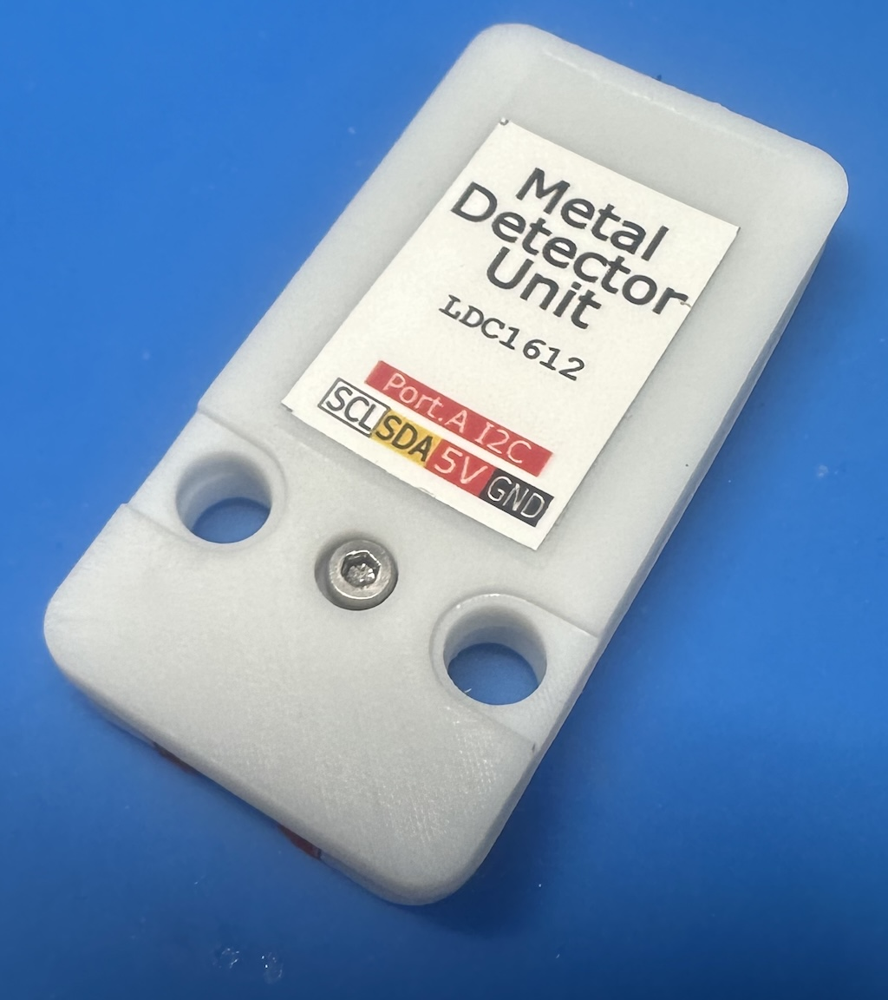
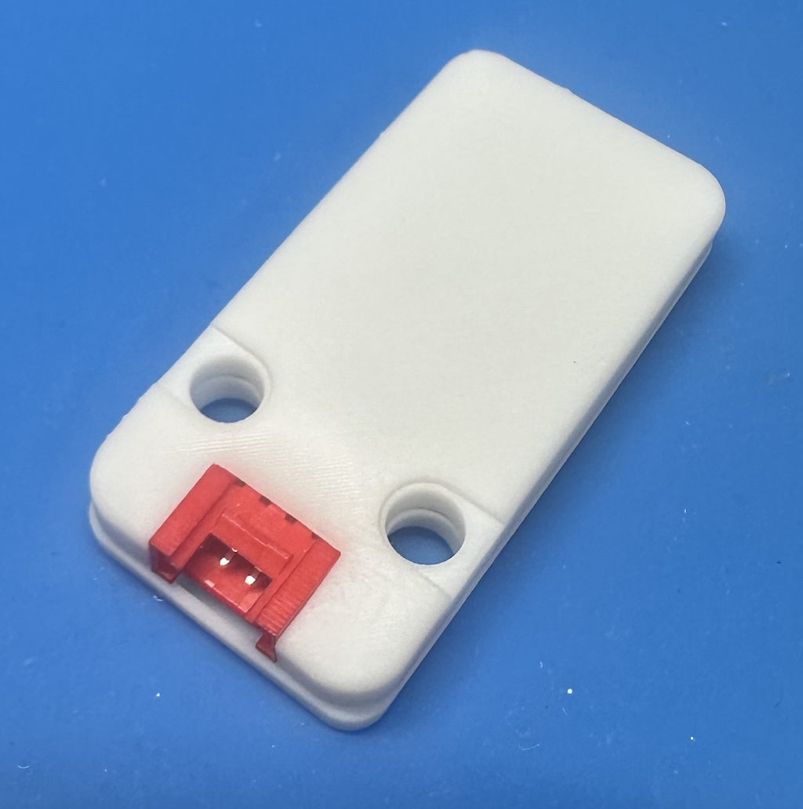
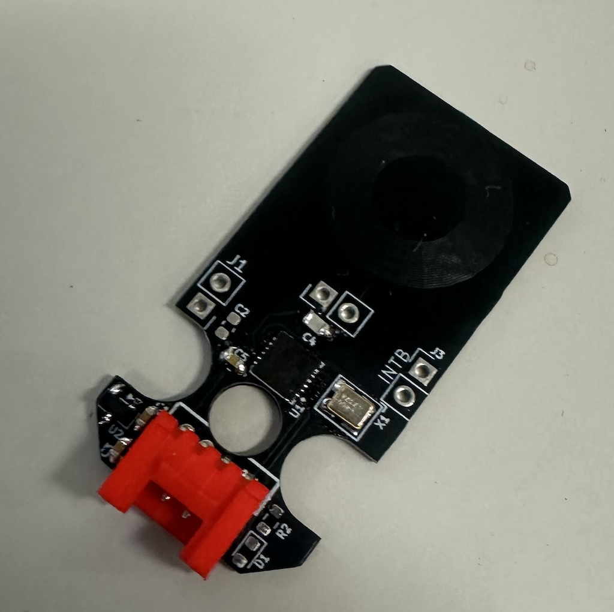

# Metal Detector Unit

基板パターンコイルで金属を検知できます。2mm程度まで近づくと検知でき、それより近くでの距離をある程度計測することもできます。
マイコンとはI2C通信のGroveケーブルで接続します。
[Seeed製「Grove 2チャンネル誘導性センサー」](https://jp.seeedstudio.com/Grove-2-Channel-Inductive-Sensor-LDC1612.html)と機能互換のため、ソフトウエア・ラリブラリは同じものを使用できます。

※電波法上の「高周波利用設備（通信設備以外）」に該当しますが、放出電磁界の強度が法令の基準以下であることを確認済みです（測定データは Measurement/ 内に掲載しています）

## 使い方

[Seeed製「Grove 2チャンネル誘導性センサー」](https://jp.seeedstudio.com/Grove-2-Channel-Inductive-Sensor-LDC1612.html)を参照してください。

## Author

Junichi Akita (@akita11) / akita@ifdl.jp
